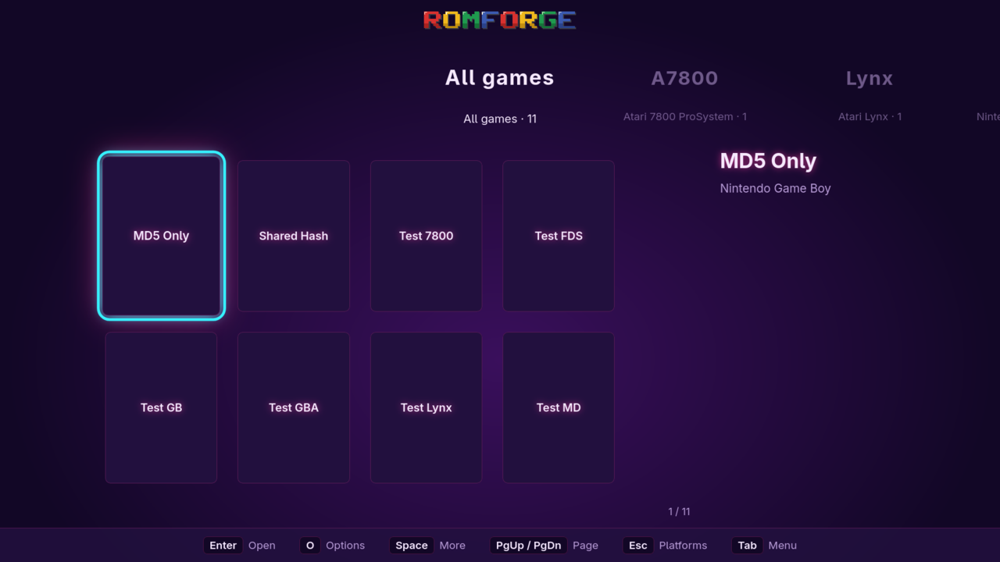
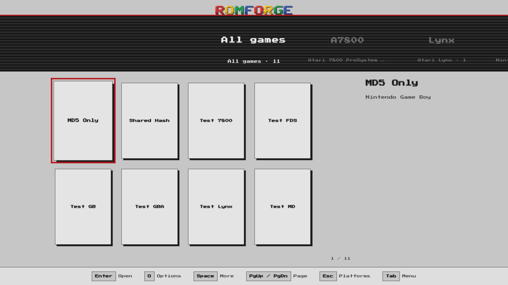
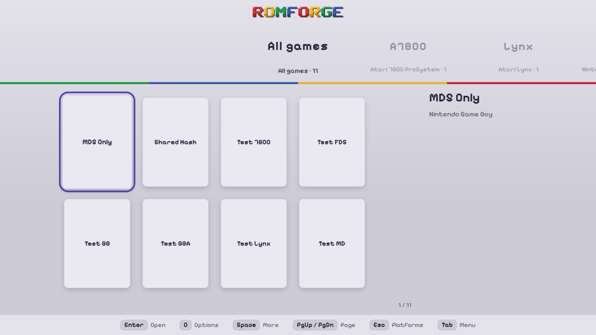
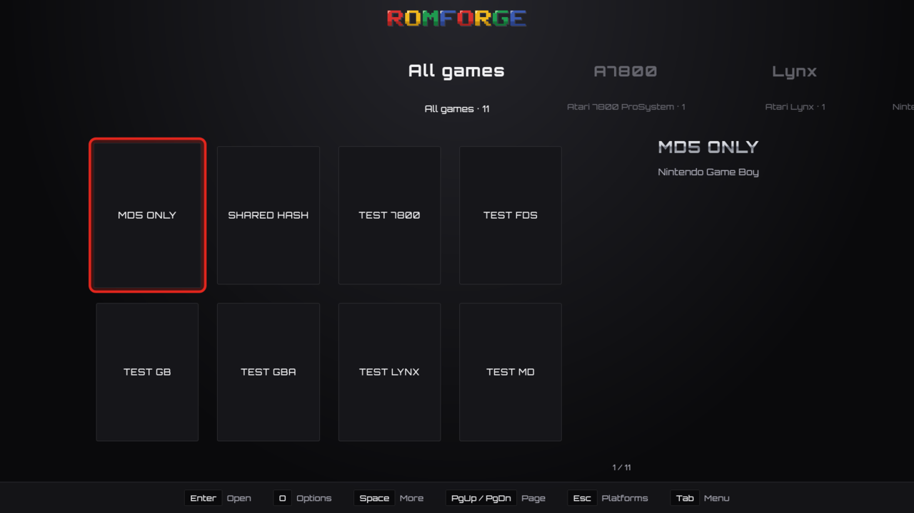
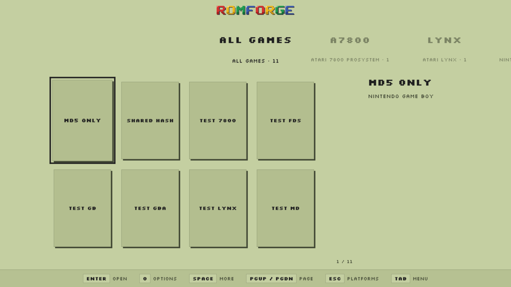

# romforge themes

Themes for the fullscreen mode of [romforge](https://github.com/asafelobotomy/romforge),
made by its community.

**To get one,** open romforge and go to **Settings → Display → Get themes…**,
or **Start → Theme → Get themes** in the fullscreen mode. Each theme's licence
is shown before you download it, and romforge checks every file before the
theme goes in.

| Theme | By | Licence |
|---|---|---|
| [Neon Arcade](themes/neon-arcade) | romforge | CC0-1.0 |
| [NES](themes/nes) | romforge | CC0-1.0, font OFL-1.1 |
| [SNES](themes/snes) | romforge | CC0-1.0, font OFL-1.1 |
| [Genesis](themes/genesis) | romforge | CC0-1.0, font OFL-1.1 |
| [Game Boy Pocket](themes/game-boy-pocket) | romforge | CC0-1.0, font OFL-1.1 |

| | |
|---|---|
|  |  |
|  |  |
|  | |

**To add yours,** see [CONTRIBUTING.md](CONTRIBUTING.md).

The files of this repository (the README, the guide, the workflow) are MIT;
each theme keeps the licence its `theme.json` names.
