# romforge themes

Themes for the fullscreen mode of [romforge](https://github.com/asafelobotomy/romforge),
made by its community.

**To get one,** open romforge and go to **Settings → Display → Get themes…**,
or **Start → Theme → Get themes** in the fullscreen mode. Each theme's licence
is shown before you download it, and romforge checks every file before the
theme goes in.

<!-- themes:start -->
| Theme | | Font |
|---|---|---|
| [Neon Arcade](#neon-arcade) | Originals | System |
| [Gruvbox](#gruvbox) | Originals | JetBrains Mono |
| [NES](#nes) | Nintendo | Press Start 2P |
| [SNES (US)](#snes-us) | Nintendo | Pixelify Sans |
| [SNES (UK)](#snes-uk) | Nintendo | Pixelify Sans |
| [Nintendo 64](#nintendo-64) | Nintendo | Russo One |
| [GameCube](#gamecube) | Nintendo | Fredoka |
| [Game Boy Pocket](#game-boy-pocket) | Nintendo | Silkscreen |
| [Game Boy Advance](#game-boy-advance) | Nintendo | DotGothic16 |
| [Master System](#master-system) | Sega | Racing Sans One |
| [Genesis](#genesis) | Sega | Orbitron |
| [Saturn](#saturn) | Sega | Michroma |
| [Dreamcast](#dreamcast) | Sega | Comfortaa |
| [PlayStation](#playstation) | Sony | Chakra Petch |
| [PlayStation 2](#playstation-2) | Sony | Exo 2 |

## Originals

### Neon Arcade

Synthwave night: deep purple, hot pink and a cyan glow, with optional scanlines.

**Colour schemes:** Midnight, Sunset · **Options:** Glow, Scanlines · **Font:** System  
**Licence:** CC0-1.0 · **By** romforge · **Version** 1.3.1 · [Files](themes/neon-arcade)

### Gruvbox

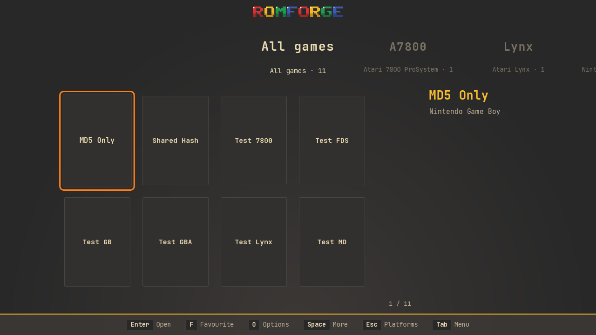

The retro groove palette, dark or light at each of its three contrasts: warm browns and cream, yellow and orange.

**Colour schemes:** Dark, Dark hard, Dark soft, Light, Light hard, Light soft · **Options:** Accent rule, Card corners · **Font:** JetBrains Mono  
**Licence:** CC0-1.0, its font OFL-1.1 · **By** romforge · **Version** 1.1.0 · [Files](themes/gruvbox)

## Nintendo

### NES

The 8-bit front-loader: two greys, black and red, square pixel cards and Press Start 2P type.

**Colour schemes:** Front loader, Control deck · **Options:** Ridged band · **Font:** Press Start 2P  
**Licence:** CC0-1.0, its font OFL-1.1 · **By** romforge · **Version** 1.2.1 · [Files](themes/nes)

### SNES (US)

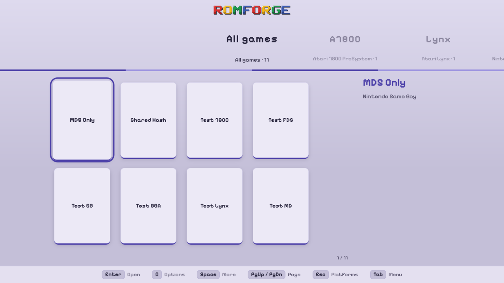

The North American Super NES: a grey shell, purple and lavender buttons, rounded corners; or a night scheme.

**Colour schemes:** USA, Night · **Options:** Button colours · **Font:** Pixelify Sans  
**Licence:** CC0-1.0, its font OFL-1.1 · **By** romforge · **Version** 1.2.1 · [Files](themes/snes-us)

### SNES (UK)

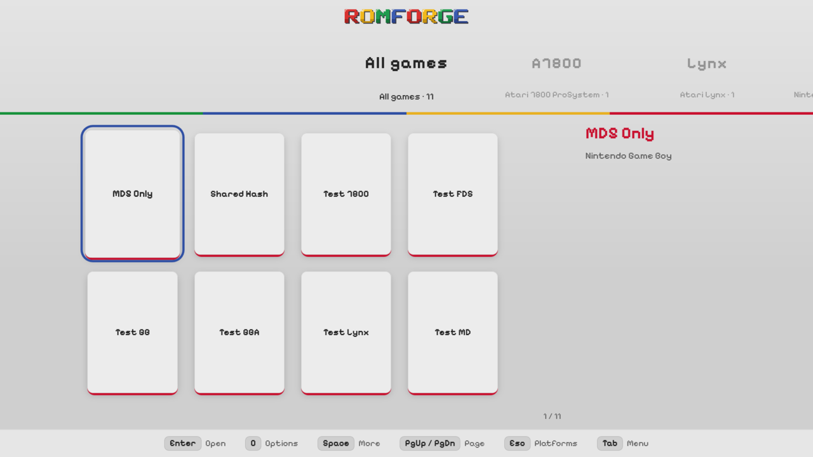

The UK and European Super Nintendo (and Japan's Super Famicom): light grey with the four coloured buttons; or a night scheme.

**Colour schemes:** PAL, Night · **Options:** Button colours · **Font:** Pixelify Sans  
**Licence:** CC0-1.0, its font OFL-1.1 · **By** romforge · **Version** 1.2.1 · [Files](themes/snes-pal)

### Nintendo 64

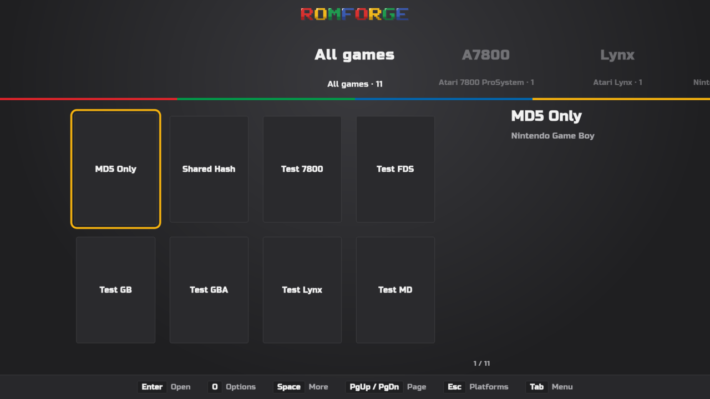

Charcoal, or the see-through Jungle Green and Grape, with the logo's four colours.

**Colour schemes:** Charcoal, Jungle green, Grape · **Options:** Logo colours · **Font:** Russo One  
**Licence:** CC0-1.0, its font OFL-1.1 · **By** romforge · **Version** 1.2.0 · [Files](themes/nintendo-64)

### GameCube

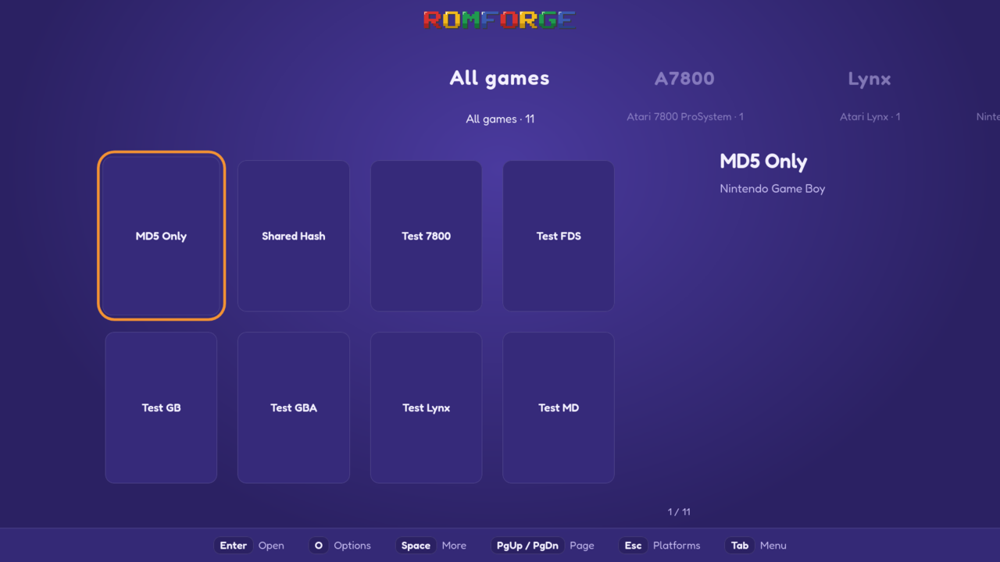

The little cube's indigo, its spice orange or jet black, with rounded cards.

**Colour schemes:** Indigo, Spice, Jet · **Options:** none · **Font:** Fredoka  
**Licence:** CC0-1.0, its font OFL-1.1 · **By** romforge · **Version** 1.2.1 · [Files](themes/gamecube)

### Game Boy Pocket

The Pocket's grey-green screen or its silver shell with magenta buttons, square cards and Silkscreen pixel type.

**Colour schemes:** Screen, Silver · **Options:** Box art · **Font:** Silkscreen  
**Licence:** CC0-1.0, its font OFL-1.1 · **By** romforge · **Version** 1.2.1 · [Files](themes/game-boy-pocket)

### Game Boy Advance

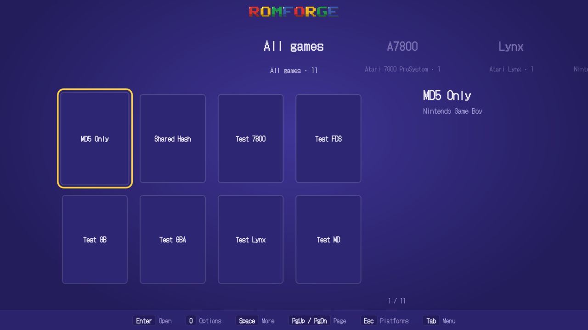

The wide handheld's see-through Indigo or Glacier, with a bright screen-yellow focus on Indigo.

**Colour schemes:** Indigo, Glacier · **Options:** none · **Font:** DotGothic16  
**Licence:** CC0-1.0, its font OFL-1.1 · **By** romforge · **Version** 1.2.1 · [Files](themes/game-boy-advance)

## Sega

### Master System

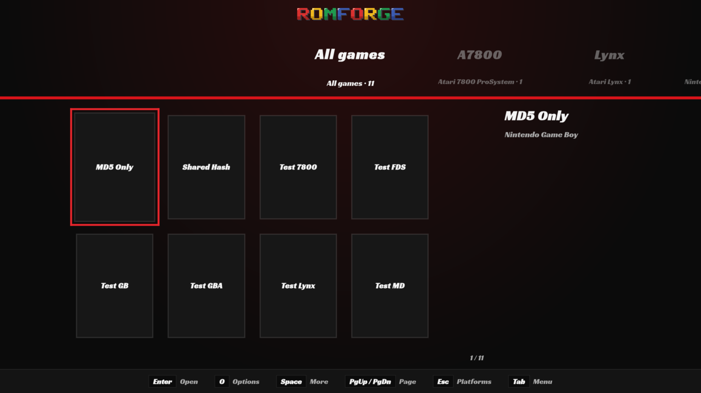

8-bit black with the console's red stripe, or the Master System II's blue; heavy italic type.

**Colour schemes:** Black, II · **Options:** Red stripe · **Font:** Racing Sans One  
**Licence:** CC0-1.0, its font OFL-1.1 · **By** romforge · **Version** 1.2.1 · [Files](themes/master-system)

### Genesis

16-bit black with red (or the gold of Japan's boxes), chrome titles and Orbitron's wide arcade type.

**Colour schemes:** Black, Gold · **Options:** Chrome titles · **Font:** Orbitron  
**Licence:** CC0-1.0, its font OFL-1.1 · **By** romforge · **Version** 1.2.1 · [Files](themes/genesis)

### Saturn

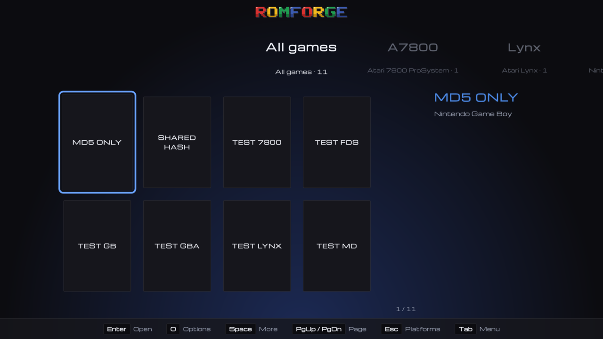

Black with the logo's blue glow, or the white Japanese console; wide, spaced type.

**Colour schemes:** Black, White · **Options:** Blue title · **Font:** Michroma  
**Licence:** CC0-1.0, its font OFL-1.1 · **By** romforge · **Version** 1.2.0 · [Files](themes/saturn)

### Dreamcast

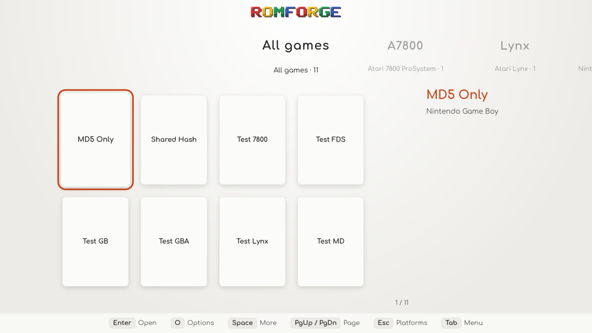

The white console with the swirl in orange (Japan and America) or blue (Europe), or a night scheme.

**Colour schemes:** Orange, Blue, Night · **Options:** none · **Font:** Comfortaa  
**Licence:** CC0-1.0, its font OFL-1.1 · **By** romforge · **Version** 1.2.1 · [Files](themes/dreamcast)

## Sony

### PlayStation

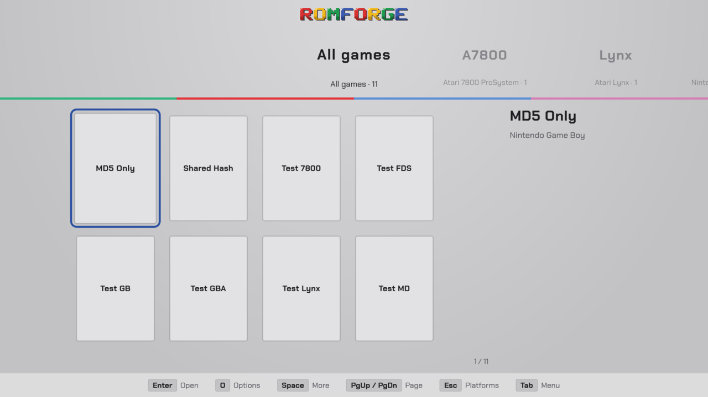

The 32-bit grey console, or the black of its boot screen, with the four button shapes' colours.

**Colour schemes:** Console, Boot · **Options:** Button colours · **Font:** Chakra Petch  
**Licence:** CC0-1.0, its font OFL-1.1 · **By** romforge · **Version** 1.2.1 · [Files](themes/playstation)

### PlayStation 2

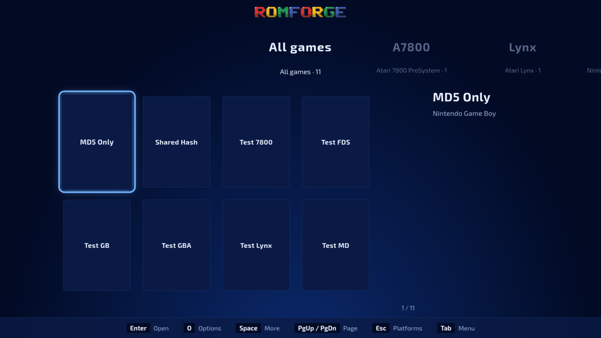

The deep blue of the console's own menus and its blue light, or the silver of the slim one.

**Colour schemes:** Browser, Silver · **Options:** Blue glow · **Font:** Exo 2  
**Licence:** CC0-1.0, its font OFL-1.1 · **By** romforge · **Version** 1.2.1 · [Files](themes/playstation-2)
<!-- themes:end -->

**To add yours,** see [CONTRIBUTING.md](CONTRIBUTING.md).

The files of this repository (the README, the guide, the workflow, tools/) are MIT;
each theme keeps the licence its `theme.json` names.
